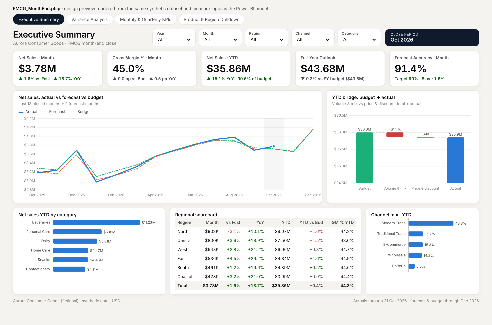
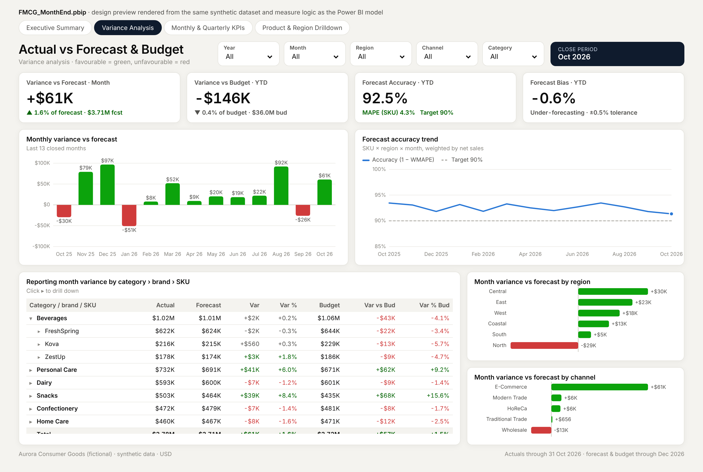
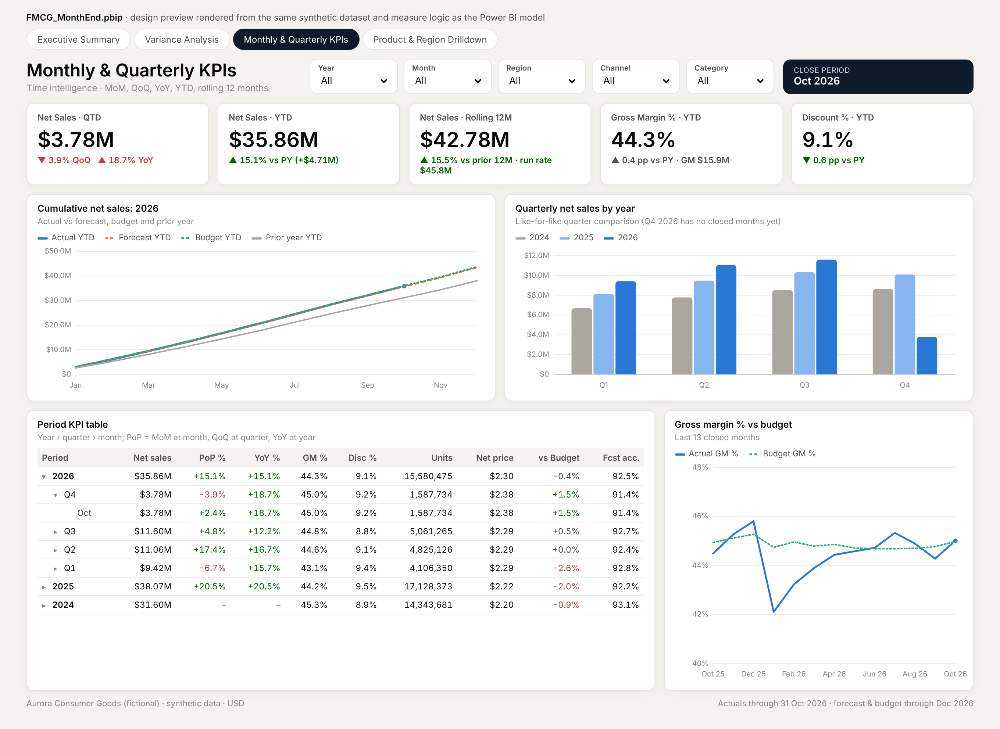
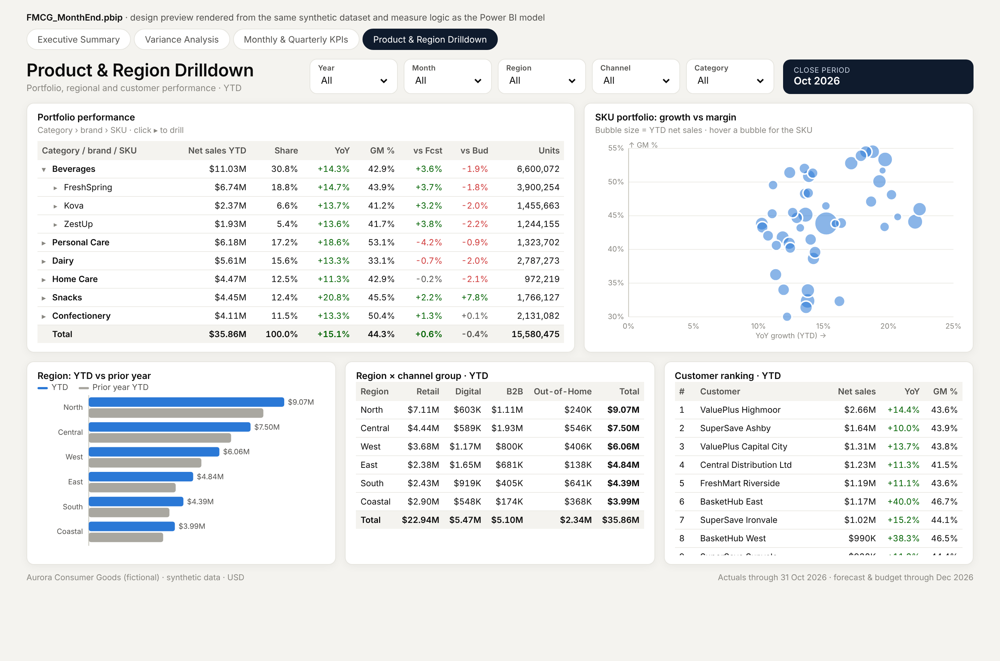

# FMCG Month-End Financial Reporting Dashboard

**Power BI · Power Query · DAX · 2026**

A month-end close report for a fictional FMCG company, *Aurora Consumer Goods*. It compares actuals against the rolling forecast and the annual budget, explains variances, tracks forecast accuracy, and reports monthly and quarterly KPIs. The data model is a star schema, and the report is driven by a library of 182 DAX measures.

> Portfolio summary: *I built a Power BI month-end report on FMCG sales data covering actuals vs. forecast, variance analysis and monthly/quarterly KPIs. I modelled the data as a star schema in Power Query and wrote DAX for YTD, QTD, MoM, YoY, forecast accuracy (WMAPE/MAPE/bias) and a price-volume budget bridge.*

## Screenshots

> Rendered from the interactive preview (`preview/dashboard-preview.html`), which uses the same data and measure logic as the Power BI model.

### Executive Summary


### Variance Analysis


### Monthly & Quarterly KPIs


### Product & Region Drilldown


## What's in the folder

| Path | What it is |
|---|---|
| `pbip/FMCG_MonthEnd.pbip` | **Power BI Project**: open this in Power BI Desktop. It contains the semantic model (TMDL) and the 4-page report (PBIR). |
| `data/` | Synthetic dataset as CSVs: 174,800 sales lines, 45,618 forecast/budget lines, 46 SKUs, 78 customers, 6 regions, 5 channels. |
| `powerquery/` | Every Power Query (M) script, one file per query. |
| `dax/measures.dax` | The full measure library as a DAX script, for DAX query view or Tabular Editor. |
| `docs/dax-measure-library.md` | Every measure with its description and code, grouped by display folder. |
| `docs/report-layout-spec.md` | Page-by-page layout: every visual, its fields, position and formatting. |
| `docs/data-dictionary.md` | Tables, columns, grain and relationships. |
| `theme/Aurora_FMCG_Theme.json` | Custom report theme (palette, cards, tables, slicers). |
| `preview/dashboard-preview.html` | Interactive HTML preview of the report, computed from the same data and measure logic. |
| `scripts/` | Python that generates the data, builds the PBIP and preview, and validates the project. |

## Open the report in Power BI Desktop

You need Power BI Desktop (Windows), a recent 2025 or 2026 release.

1. **Copy the data.** Put the `data` folder somewhere local, for example `C:\FMCG-MonthEnd\data\`. That path is the default, so if you use it you can skip step 4.
2. **Enable the project preview features.** In Power BI Desktop go to *File › Options and settings › Options › Preview features* and tick **Power BI Project (.pbip) save option**, **Store semantic model using TMDL format** and **Store reports using enhanced metadata format (PBIR)**. Restart Desktop.
3. **Open** `pbip/FMCG_MonthEnd.pbip`. Keep the `.pbip` file next to the two `FMCG_MonthEnd.*` folders.
4. **Point it at the data** (only if you used a different folder). Go to *Home › Transform data › Edit parameters* and set **DataFolder** to your folder. Keep the trailing backslash.
5. **Refresh.** Click *Home › Refresh*. The project ships without cached data, so the visuals stay empty until the first refresh, which takes 10–20 seconds.
6. **Save as .pbix** if you want a single file to share: *File › Save as › Power BI file (.pbix)*.

### If the project doesn't open

The PBIP was generated by script, not saved from Desktop. Every report file passes Microsoft's published PBIR JSON schemas, and every field and DAX reference has been checked against the model. It has not been opened in Power BI Desktop yet, though, because that only runs on Windows. If your Desktop version rejects a file, the error dialog names it. You can also rebuild the report by hand in about an hour:

1. New report › *Get data › Blank query* › open the *Advanced editor* and paste each file from `powerquery/`. Name the queries exactly as the file names (`Date`, `Product`, `Customer`, `Region`, `Channel`, `Fact Sales`, `Fact Forecast`, `Variance Bridge`, `_Measures`), and create the `DataFolder` text parameter first.
2. In *Model view*, create the 9 relationships listed in `docs/data-dictionary.md`. They are all single-direction, one-to-many, from the dimension to the fact.
3. Mark `Date` as the date table (*Table tools › Mark as date table*, column `Date`). Set *Sort by column* for Month, Month Year, Quarter, Year Quarter and Weekday.
4. Add the calculated columns `Is Actual Period`, `Month Offset` and `Year Offset` to `Date`. Their code is in `docs/data-dictionary.md`.
5. Open *DAX query view*, paste `dax/measures.dax`, click **Update model with changes**, then run it. All 182 measures are created in `_Measures`.
6. *View › Themes › Browse for themes* › `theme/Aurora_FMCG_Theme.json`.
7. Build the four pages from `docs/report-layout-spec.md`. The HTML preview shows what each page should look like.

## Model at a glance

```
            Date ──────────┐                ┌────────── Date
         Product ──────────┤                ├────────── Product
        Customer ──── Fact Sales      Fact Forecast ─── Region
          Region ──────────┤   (daily order lines)  │   (month × SKU × region × channel:
         Channel ──────────┘                └────────── Channel   forecast + budget)

  _Measures (182 measures)  ·  Variance Bridge (waterfall helper)  ·  DataFolder (parameter)
```

* **Fact Sales**: one row per order line, from Jan 2024 to Oct 2026. It holds units, gross sales, discounts, net sales and COGS.
* **Fact Forecast**: the latest rolling forecast and the budget at month × SKU × region × channel grain, from Jan 2024 to Dec 2026, so it covers the remaining months of the year.
* **Conformed dimensions**: Date, Product, Region and Channel filter both facts, so every slicer works on actual vs plan comparisons. Customer filters actuals only, because plans aren't set at customer level.

## How the reporting logic works

* **One anchor date.** Every `(Month)`, `(QTD)`, `(YTD)` and `(R12M)` measure is anchored on `[Reporting Date]`. That is the end of the period picked in the Year/Month slicers, capped at the last month with actuals. With nothing selected, the report shows the latest close (October 2026) and rolls forward when new actuals land.
* **Like-for-like plan comparisons.** Variances use `Forecast/Budget Net Sales (Closed)`, which only counts months that have actuals. A YTD variance therefore never compares 10 months of actuals against 12 months of budget.
* **Forecast accuracy done properly.** `Forecast Accuracy %` is 1 − WMAPE, with absolute errors summed at SKU × region × month grain, so over- and under-forecasts don't cancel out. `MAPE %` (unweighted, SKU × month) and `Forecast Bias %` sit next to it.
* **Budget bridge.** `Volume & Mix Effect` and `Price & Discount Effect` split the budget variance at SKU × month grain, and they add up exactly to the total variance. They feed the Budget → Actual waterfall.
* **Context-aware time intelligence.** `PoP %` shows MoM at month level, QoQ at quarter level and YoY at year level in the same matrix.
* **Formatting is measure-driven.** The KPI subtitles (▲/▼ with %) and the green/red conditional formatting come from measures in the `09 Labels & Formatting` folder, so the colour rules live in one place.

## The story in the data (October 2026 close)

The synthetic data has deliberate events, so the variance pages have something to explain:

* **Personal Care in E-Commerce** jumped in October with an online mega-sale. It is the largest favourable variance to forecast.
* **Beverages in the North** fell short in September and October, after a cool, wet autumn the forecast didn't anticipate.
* **Snacks in Modern Trade** has run above plan since August, after a new shelf-space agreement.
* **Home Care in Wholesale** was down in October as a distributor ran down its stock.
* **Budget vs actual**: YTD net sales are 0.4% below budget, and the bridge shows almost all of that gap comes from volume and mix, not price. E-Commerce was under-budgeted and is running well ahead, while Beverages and Home Care are behind.
* **Forecast accuracy** is about 91–93% at SKU × region level against a 90% target, with a slight under-forecasting bias of −0.6% YTD.

## Regenerating everything

```bash
cd scripts
python generate_data.py          # data/*.csv (fixed seed, so it's reproducible)
python build_pbip.py             # pbip/, powerquery/, dax/, theme/, docs/dax-measure-library.md
python build_preview_data.py     # preview/dashboard-preview.html
python validate_project.py <schema-folder>   # optional: PBIR schema + reference checks
```

To change a measure, edit it in `build_pbip.py` and rebuild. The model, the DAX script and the measure docs are all generated from that one file.
